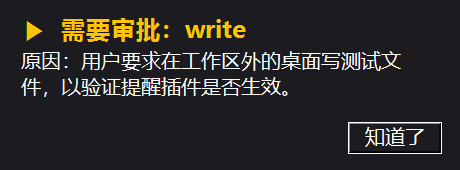

# 中断提醒

DSH 有两种请求会把一轮对话卡住等你：**审批**（`approval/request`）和**提问**（`ask_user_question` → `user-questions/request`）。本插件在这两种请求出现的瞬间给你三个桌面信号：

- **置顶弹窗**（右下角，深色卡片，写明是审批还是提问、原因或问题原文，60 秒自动关闭）
- **提示音**（系统告警音）
- **任务栏闪烁**（DSH 窗口按钮反复闪，直到弹窗关闭）

## 为什么需要

这两类请求只出现在 DSH 窗口内部。窗口在后台时你收不到任何提示——实测有一次审批从 14:27 一直挂到 14:46，19 分钟里任务完全卡住而无人知晓。

| 审批 | 提问 |
|---|---|
|  |  |

## 关键实现细节（踩过的坑）

### 1. 不能用 `ctx.on('approval/request')`

审批服务这样派发：

```js
this.ctx.waterfall(scopeTarget(req.agent, req.agent), 'approval/request', req, ...)
```

首个参数是 scope 接收器，cordis 在 `_resolve` 里按它过滤监听器：

```js
.filter(hook => hook.global || !filter || filter.call(thisArg, hook.ctx))
```

插件上下文的 scope 标记为空（`scope-symbols=[]`），但仍被 agent 自身的 filter 拒绝——加 `{ global: true }` 也没用。实测 `direct=false`，即正面监听器从未被调用。提问走同一条路径（`ctx.userQuestions` 同样用 `scopeTarget(agent, agent)` 派发），因此同样收不到。

**改用旁路**：`internal/dispatch` 在过滤**之前**同步广播，能拿到 `(type, name, args, thisArg)`：

```js
ctx.on('internal/dispatch', (type, name, args) => {
  const describe = INTERRUPTS[name]
  if (!describe) return
  fire(...Object.values(describe(args[0])))
})
```

`INTERRUPTS` 表里两项：`approval/request` 读 `{ toolName, reason }`；`user-questions/request` 读 `questions[]`，取首问原文并标注问题总数。`args[0]` 就是请求对象，两种事件的形状一致。

### 2. 不能 `detached: true`

Windows 上给宿主进程的 PowerShell 子进程加 `detached: true`，子进程会**静默退出**：`exit code 0`、无输出、无窗口、脚本第一行都没执行。与 `-EncodedCommand`／`-File` 无关，只与 detached 有关（4 种组合实测）。去掉 detached、保留 `unref()` 即可。

### 3. 其他

- 弹窗尺寸用 `ClientSize`（不是 `Height`，否则按钮会被标题栏裁掉），并按 `TextRenderer.MeasureText` 实测换行高度自适应。
- 提示音用 `[System.Media.SystemSounds]::Exclamation.Play()`；`[console]::beep` 在无控制台的隐藏进程里会抛异常。
- 窗口用标题枚举定位（`EnumWindows` + 标题含 `DeepSeek Harness`），不能按进程名匹配——DSH 主窗口属于独立进程，`MainWindowHandle` 为 0。
- 所有通道都写日志到 `%LOCALAPPDATA%\dsh-approval-alert\alert.log`，失败不再静默。

## 行为

- 每次中断提醒一次；同一类提醒 1.5 秒内去重，审批与提问互不影响。
- 审批：正文为「原因：…」；提问：正文为「问题：…（共 N 个问题）」。
- 不参与决策：提醒后仍由原来的应答链决定结果，绝不改变审批结论或替你回答问题。

## 限制

- 仅桌面端（Windows）。
- 远程/无头环境没有可闪烁的窗口，弹窗也不会显示。
- 策略为「完全访问」（不询问）时不会有审批请求，因此审批类提醒不会出现；提问不受策略影响，仍会提醒。

## 验证记录

| 场景 | 方式 | 结果 |
|---|---|---|
| 审批（真实） | 工作区外写文件触发真实 `approval/asked` | `dispatch observed` → `notify` → `flash=ok sound=ok window=open`，弹窗被点击关闭 |
| 审批（真实） | `pwsh` 工具提权 | 同上，连续两次 |
| 提问（合成） | 临时插件派发真实 `user-questions/request` | `dispatch observed name=user-questions/request` → 弹窗出现 |
| 文本映射 | 直接断言 `describeInterrupt` | 审批/提问/多问/空问/未知事件五种输入均正确 |
| 布局 | 窗体内 `DrawToBitmap` 渲染 | 短文本 460×150、长文本 460×278，按钮与文本均不裁切 |

日志：`%LOCALAPPDATA%\dsh-approval-alert\alert.log`（超过 256 KB 自动清空）。
